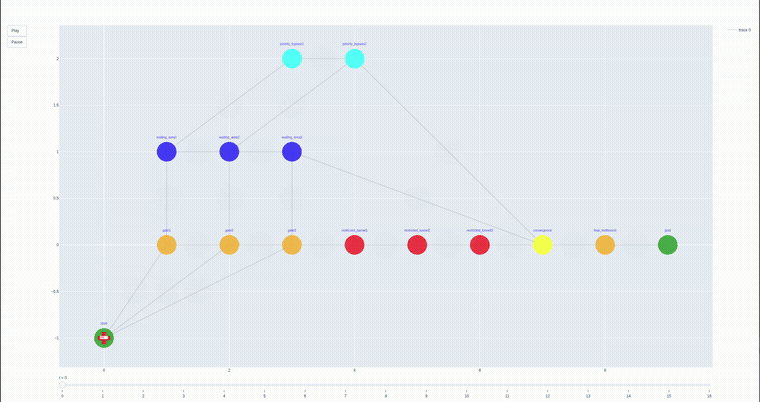
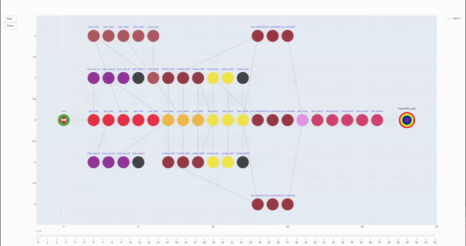

# Fly-In 🚁

**Multi-drone routing simulator** — pathfinding and conflict resolution for fleets of drones navigating a shared network of zones, built for the 42 common core curriculum.


<p align="center">
  
  
</p>

<p align="center"><em>Interactive Plotly visualization of drones navigating a shared zone network, with Conflict-Based Search resolving collisions and capacity constraints in real time.</em></p>

> This project was created as part of the 42 curriculum by **tkunugi**.

---

## Table of Contents

- [Overview](#overview)
- [Installation](#installation)
- [Usage](#usage)
- [Example](#example)
- [Algorithm](#algorithm)
  - [High-Level Solvers](#high-level-solvers)
  - [Low-Level Planner: A\*](#low-level-planner-a)
- [Visualization](#visualization)
- [Tech Stack](#tech-stack)
- [Resources](#resources)
- [AI Usage](#ai-usage)

---

## Overview

**Fly-In** designs an efficient drone routing system that navigates multiple drones through connected zones while minimizing simulation turns and handling real-world movement constraints: zone capacity, restricted connections, priority zones, and collision avoidance.

Given a map of zones (hubs) and connections, the planner computes a conflict-free, turn-by-turn schedule for every drone from its start hub to its goal hub — and renders the result as an interactive, time-scrubbable graph.

## Installation

Create the virtual environment and install dependencies:

```bash
make install
```

## Usage

| Command | Description |
|---|---|
| `make run` | Run the simulation |
| `make debug` | Run with debug output |
| `make test` | Run the test suite |
| `make lint` | Run lint checks |
| `make lint-strict` | Run strict lint checks |
| `make clean` | Clean generated project files |

## Example

**Input** (`maps/easy/01_linear_path.txt`)

```
nb_drones: 2

start_hub: start 0 0 [color=green]
hub: waypoint1 1 0 [color=blue]
hub: waypoint2 2 0 [color=blue]
end_hub: goal 3 0 [color=red]

connection: start-waypoint1
connection: waypoint1-waypoint2
connection: waypoint2-goal
```

Two drones start at `start` and must each reach `goal` through `waypoint1` and `waypoint2`. The link `start-waypoint1` has default capacity 1, so they cannot both enter `waypoint1` at the same time — CBS staggers their departure to avoid a conflict.

**Output** (`Drone_paths.txt`)

```
D2-waypoint1
D1-waypoint1 D2-waypoint2
D1-waypoint2 D2-goal
D1-goal
```

Each line represents one simulation turn. Only drones that moved are listed.

## Algorithm

The project uses a two-level architecture.

> **Objective:** minimize simulation turns.

### High-Level Solvers

Two different global planners are implemented:

**1. Conflict-Based Search (CBS)** — `solve()`

- computes an initial path for every drone using A\*;
- detects collisions between drones;
- creates a conflict-tree node containing constraints;
- branches into two child nodes, each forbidding one of the conflicting drones from occupying the problematic zone at the given time;
- replans only the affected drone;
- repeats until no conflicts remain.

CBS produces near-optimal solutions while minimizing unnecessary replanning.

**2. Sequential Planner (Fallback)** — `solve2()`

Used as a fallback strategy when CBS exceeds the iteration limit. Drones are planned one after another:

- previously planned paths are converted into an occupancy table;
- zones that are already full are transformed into constraints;
- A\* computes a path while avoiding those constraints.

Although less optimal than CBS, it is simpler and guarantees a feasible solution in difficult scenarios.

### Low-Level Planner: A\*

Both high-level solvers rely on the same low-level path planner. A\* takes into account:

- blocked zones;
- restricted connections with additional travel time;
- priority zones;
- waiting actions;
- time-dependent constraints generated by the high-level planner.

The evaluation function is:

```
f(n) = g(n) + h(n) + extra_cost + priority_bonus
```

where `g(n)` is elapsed time, `h(n)` is the heuristic distance to the goal, `extra_cost` models restricted connections, and `priority_bonus` encourages the use of priority zones.

Before running A\*, a reverse Breadth-First Search computes the minimum number of steps from every zone to the goal.

## Visualization

The project includes an interactive visualization built with **Plotly** to explore simulation results.

**Features**

- zones rendered as colored nodes, with connections revealed on hover;
- different zone types (normal, priority, restricted, blocked);
- drone paths animated over time;
- collisions and occupancy constraints highlighted;
- waiting actions and delayed movements.

Colors follow the standard Plotly CSS color palette.

Compared with textual output alone, the interactive map offers a faster, more intuitive way to analyze simulation results — it's especially useful for demonstrating how conflicts are resolved and how drones dynamically adapt their routes to reach their destination safely.

## Tech Stack

- **Python 3.13**
- [`pydantic`](https://docs.pydantic.dev/) — data validation
- [`inquirer`](https://github.com/magmax/python-inquirer) — interactive CLI prompts
- [`plotly`](https://plotly.com/python/) — interactive visualization
- [`pyfiglet`](https://github.com/pwaller/pyfiglet) — ASCII banners
- [`termcolor`](https://github.com/termcolor/termcolor) — colored terminal output

## Resources

- [Plotly Docs](https://plotly.com/python/)
- [Plotly example](https://data-analytics.fun/2021/06/12/plotly-line-scatter-details/)

## AI Usage

AI assistance was used for: edge-case identification, test ideas, and English writing (especially docstrings).
